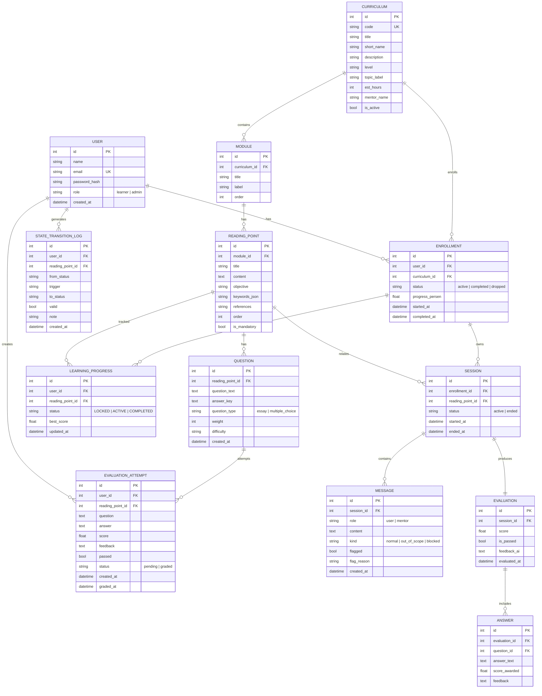

# ERD VAME (Virtual Assistant Mentor Edukasi)

Skema relasional menurut SRS Appendix B.2.

## 7 status belajar (state machine)

`LOCKED` → `ACTIVE` → `COMPLETED` (semua di `learning_progress.status`). Transisi tidak valid dicatat di `state_transition_logs` (`valid = false`).

## Repositori terkait

- `backend/app/models.py` — definisi SQLAlchemy
- `backend/app/database.py` — session & engine
- `backend/app/seed_data.py` — seed 3 kurikulum, 14 poin Python
